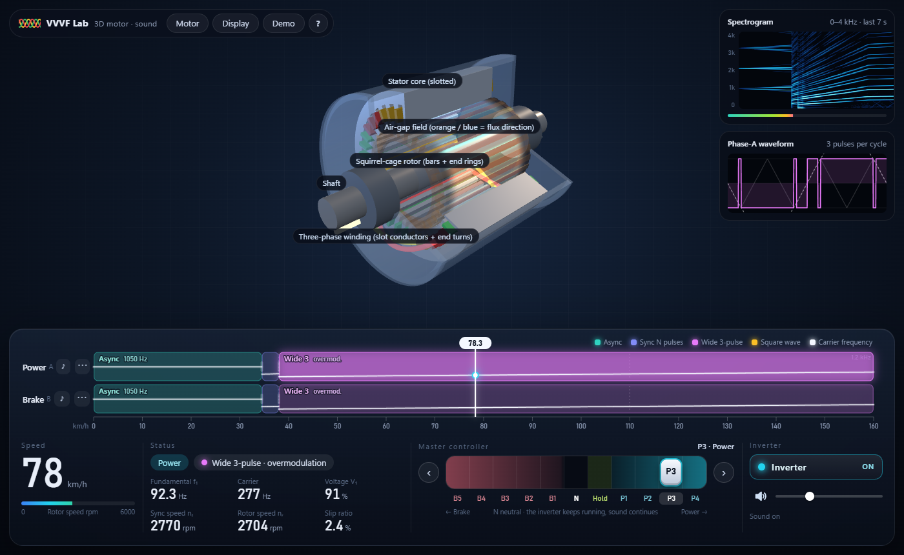
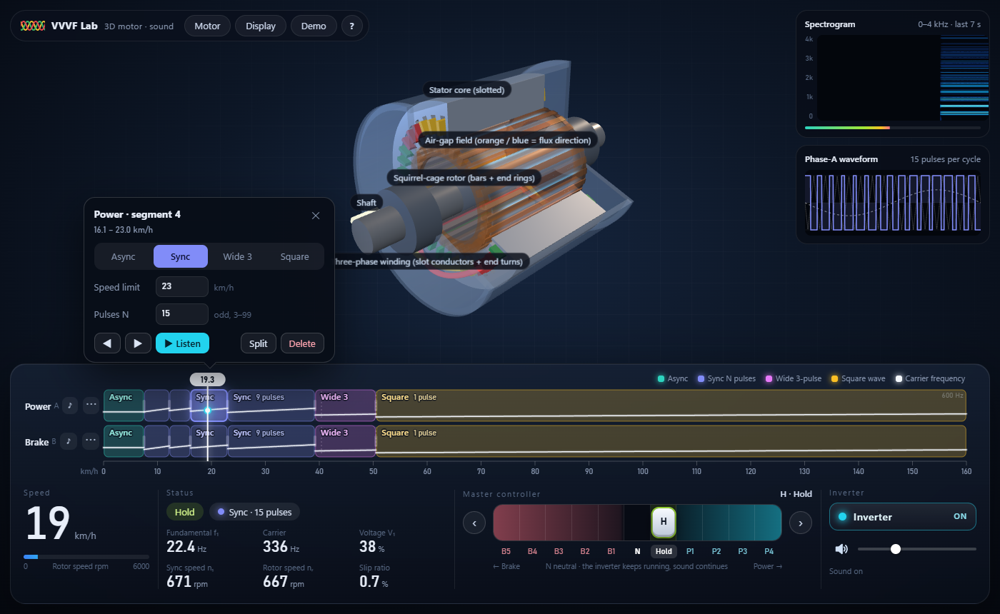
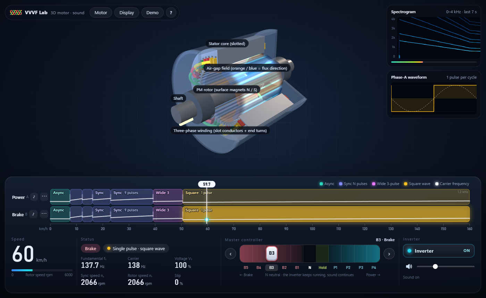
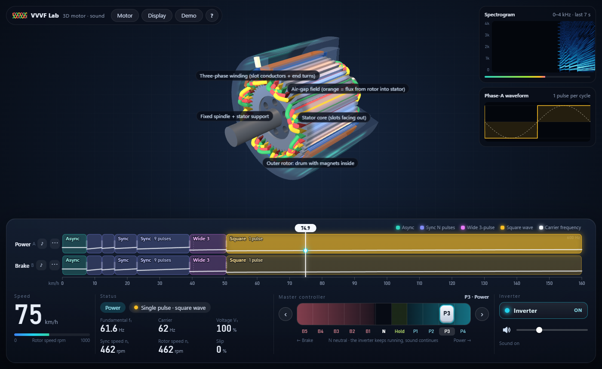
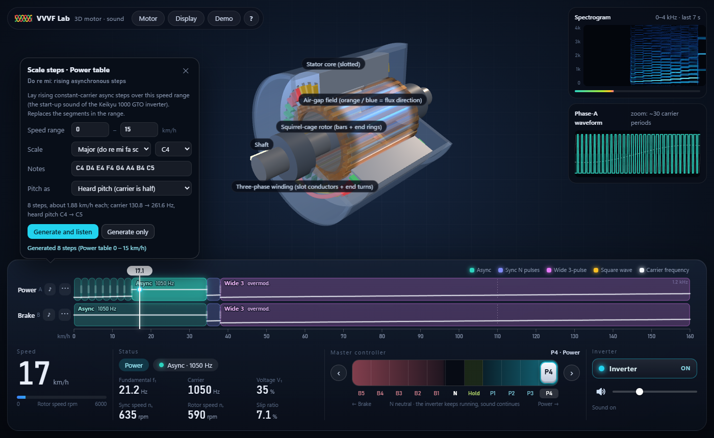
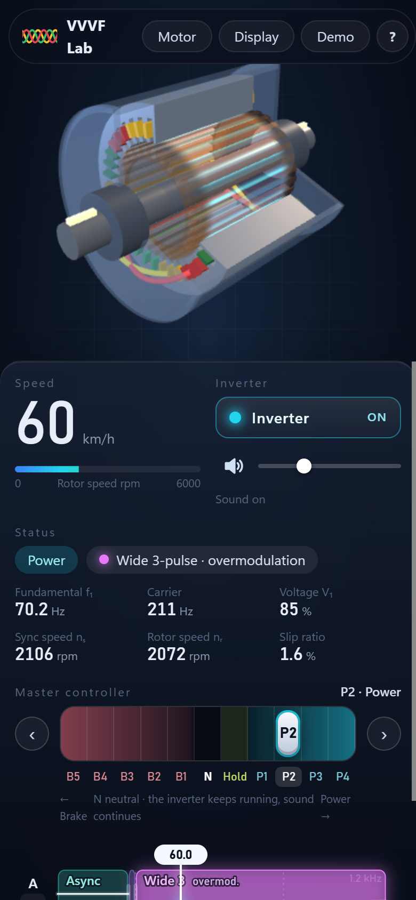

# VVVF Lab web demo: cab deck · 3D motor · sound

Push the master controller and the train speeds up, the rotor in the 3D motor spins, and you hear the inverter: carrier, synchronous pulse count and wide 3-pulse step up one after another. Which modulation is used in every speed range is up to you: change it on the ruler and hear the result immediately.









## Opening it

**Live demo:** https://jasonxig.github.io/vvvf-lab/

Or double-click [index.html](index.html), or double-click `run_web.bat` one level up. No server and no internet are needed: three.js r159 (MIT) is already in `vendor/`. The browser console shows one three.js "script build is deprecated" notice, which is normal.

**Click the page once to enable sound.** Browsers only let a page make sound after a click or key press. Click anywhere, or just move the controller; the bottom-right of the cab deck tells you whether sound is on. The default volume is 30%; check it before putting on headphones.

The first time you open it there is a "How to play" card; the `?` at the top brings it back at any time.

URL parameters open the page in a given state:

| Parameter | Meaning | Example |
| --- | --- | --- |
| `type` | Motor type: `induction`, `pmsm`, `ipmsm`, `outer-rotor` | `?type=outer-rotor` |
| `speed` | Vehicle speed in km/h | `?speed=60` |
| `notch` | Controller notch: `B5`…`B1`, `N`, `H`, `P1`…`P4` | `?notch=P3` |
| `map` | Replace both the power and brake tables with a preset: `reference`, `gto`, `igbt`, `scale` | `?map=igbt` |
| `cut` | `0` means no cut-away (housing, or the drum of an outer rotor) | `?cut=0` |
| `demo` | `1` starts the automatic demo | `?demo=1` |
| `coach` | `0` hides the first-run tips | `?coach=0` |
| `worklet` | `0` skips AudioWorklet and forces the fallback (for testing) | `?worklet=0` |
| `pedal` | Old parameter: `power` is P4, `brake` is B3 | `?pedal=power` |

## The cab deck

The strip at the bottom is the cab deck. Top to bottom, left to right:

### Master controller

A horizontal rail: brake on the left, neutral in the middle, power on the right. **Drag the handle, click a notch, click the ‹ › buttons at the ends, or use the keyboard:** `↑` / `W` one notch towards power, `↓` / `S` one notch towards braking, `Space` back to neutral N, `H` hold speed. The controller stays where you put it; there is nothing to hold down.

| Notch | Meaning |
| --- | --- |
| P1 – P4 | Power. Acceleration is 25% / 50% / 75% / 100% of the full notch; slip, field and current scale the same way |
| H | Hold: the tractive effort exactly cancels the resistance and the speed stays constant, good for parking at one speed range and listening carefully |
| **N** | **Neutral: no traction and the train slowly decelerates, but the inverter keeps running (zero torque, zero slip, only maintaining the field), so the sound continues**; the pitch follows the speed slowly and only goes quiet when the train is almost stopped |
| B1 – B5 | Braking. B5 is the full notch (3.5 km/h/s), B1 is 20% |

If both directions are pressed at once, braking wins.

> **Why the sound is still there in neutral:** on a real train the inverter usually stops switching when coasting, and the sound is gone. This page is for learning and listening, so in neutral the inverter keeps running at zero torque. That way you can park the train in any speed range and keep listening. Switching the inverter off (see below) is what really means "no traction, no sound". Once the train has almost stopped (fundamental frequency below 0.5 Hz) the sound fades away naturally, because at zero frequency there is nothing to hear.

How the speed changes (a simplified demo model): under power, constant acceleration up to 40 km/h and constant power above that (acceleration falls in inverse proportion to speed); braking follows the notch; plus a running resistance that grows with speed.

### Mode ruler: speedometer, slider and mode-table editor in one

The horizontal axis is vehicle speed from 0 to 160 km/h. The upper lane is the **power table**, the lower lane the **brake table**. Each segment is coloured by modulation kind (teal = async, indigo = sync N pulses, magenta = wide 3-pulse, amber = square wave). The **white line inside is carrier frequency against speed** (which is the pitch), and the dot on it is where you are now.

- **The vertical line is the current speed.** Drag it, or press and drag anywhere on the ruler, and the speed jumps there while the sound and the 3D motor follow. After you let go the train carries on with the current notch (in neutral the sound keeps going).
- **Drag the boundary between two segments** to change the speed range (rounded to 0.5 km/h; it cannot cross a neighbouring boundary).
- **Click a segment** to open the editor:
  - modulation kind: async, sync, wide 3, square;
  - speed limit (the last segment extends to the top speed and cannot be changed);
  - async: start and end carrier frequency, linear within the segment; sync: pulse count N (an odd number from 3 to 99);
  - ◀ ▶ move to the previous / next segment, "Split" cuts a segment in two, "Delete" merges it into its neighbour;
  - **▶ Listen**: in the power table, jump to the middle of the segment and hold the speed; in the brake table, jump to its high-speed end and glide through with the lightest braking.
  - If you get something wrong (a speed limit below the previous one, an even pulse count) it tells you why and the table is left unchanged.
- **♪ beside a lane name**: scale steps, lay "do re mi" in one click; see the next section.
- **⋯ beside a lane name**: presets (reference example, GTO type, IGBT type, scale-style async), the voltage curve (the two speeds for full modulation and full voltage, shown as dashed lines on the ruler), copy to the other table, reset, export / import JSON. Tables are saved in the browser (localStorage) and are still there next time.

### Adding modulations at different speeds: the Keikyu 1000 "do re mi" as an example

Say you want 7 more rising asynchronous steps in the first 15 km/h. There are two ways.

**Way 1: scale steps (recommended).** Click the **♪** beside the Power lane name and fill in:

| Item | Default | Notes |
| --- | --- | --- |
| Speed range | 0 – 15 km/h | The steps are laid over this range and **replace** the segments in it; segments outside are kept as they were (a segment crossing the boundary is truncated, and an async ramp is linearly interpolated at the cut, so the curve does not jump) |
| Scale, root | Major, C4 | Major (do re mi fa sol la ti do), natural minor, pentatonic, chromatic; root C3 – B5 |
| Notes | `C4 D4 E4 F4 G4 A4 B4 C5` | Filled in when you pick a scale; you can also edit it: note names (`C4`, `F#3`, `Bb4`) or plain frequencies (`523`), separated by spaces, as many steps as notes |
| Pitch as | Heard pitch | See the note below |

Press **Generate and listen**: the table immediately gains 8 constant-carrier asynchronous segments rising from low to high, and the page accelerates from the start with P4 so the steps sound one after another; in the spectrogram they are a staircase going up. **Generate only** changes the table without moving the train. The brake table (the lower lane) can be done too; listening then starts at the end with B2, so the scale comes down.



> **Why the carrier is only half of the heard pitch with "Pitch as heard pitch":** in the three-phase line voltage the carrier itself (fc) cancels, and the two main groups of lines left are **fc ± 2f₁** (strength roughly proportional to the modulation index squared) and **2fc ± f₁** (roughly proportional to m). When m is small the second group is much stronger, so the pitch you hear is about twice the carrier: to hear C4 (262 Hz) set the carrier to 131 Hz. With "Carrier frequency itself" the numbers you write are used as the carrier directly.
>
> The two groups are equally loud at **m ≈ 0.7** (about 27 km/h with the default voltage curve, counting the ripple current falling with frequency); above that the lower group is louder and the heard pitch drops back to the carrier itself. So put the steps in the low-speed range; the first 15 km/h is just right.
>
> Measured (the default 8 steps, accelerating through with P4): the strongest line in each step's spectrum is within 0.5% – 4% of the target note, slightly low because the strongest is the 2fc − f₁ sideband; the beating between the two sidebands (2f₁) is the roughness typical of inverter sound.
>
> Click any step and the editor shows "heard pitch about N Hz (nearest note name and cents deviation)", which helps with manual tuning.

**Way 2: by hand.** Click the first segment (0 – 34.5 km/h async 1050 Hz) → set its "speed limit" to 15 → press "Split" to cut it in two, then keep splitting each half… select each step on its own and set the start and end carrier (the same number in both boxes is a constant carrier). 8 steps take 7 splits and 16 numbers, which is why way 1 exists. The ready-made **scale-style async** preset (load it from the ⋯ menu) is the same thing: heard pitch C4 – C5, one step per 2.5 km/h, laid over 0 – 20 km/h.

**The real Keikyu 1000** used a Siemens GTO inverter, and I have no data on its actual pitches or the speed range of each step; the "do re mi" here is a sketch laid out as a major scale. The speed and pitch of every step can be changed, and it can be calibrated once there is a recording to compare with.

The segment lit up in a lane is the one the inverter is using right now; the brighter, glowing state means the inverter is switching.

### Readouts, inverter, sound

- **Speed** and the rotor-speed bar below it (the colour is the same set as the blur on the rotor in 3D: blue → cyan → green → yellow → red). Its full scale follows the drivetrain: 6000 rpm with the 5.6 gearbox, 1000 rpm for the direct-drive outer rotor.
- **Status**: Power / Neutral / Hold / Brake / Stopped, and the current modulation; when the inverter is not running it says why (inverter off, regenerative brake released, inverter standby). Six readouts: fundamental frequency f₁, carrier, voltage V₁ (a square wave is 100%), synchronous speed, rotor speed, slip ratio.
- **Inverter lamp**: off means no tractive effort and no regenerative braking: power and hold can only coast, and braking is mechanical only (no sound, and the field disappears too). Regenerative braking is released below 1 Hz of fundamental frequency and handed over to mechanical braking.
- **Speaker** and volume bar affect only the sound, not the train. `M` mutes.
- Top right: the **spectrogram** (last 7 seconds, 0–4 kHz vertically, so you can see the flat carrier line and the slanting synchronous lines) and the **switching waveform** (the ±1 output of the phase-A leg with the reference sine and triangle carrier, so you can see "how many pulses" at a glance; when the async carrier is too dense it zooms in to 30 carrier periods). The thin bar under the spectrogram is loudness and does not move when there is no sound.
- Top left: **Motor** (type, JSON motor definition), **Display** (how speed is shown, scene options), **Demo** (automatic: accelerate with P4 to 120 km/h → neutral coasting for 4 s → brake to a stop with B3 → repeat; touching the controller or the ruler stops it), **?** (how to play). `P` pauses the animation.

On a narrow screen (phone portrait) the cab deck becomes a bottom sheet with the motor above it and the editor above the ruler; the controller and the ruler both support touch dragging.



On small laptop screens (1280×720, 1024×640) the cab deck is squashed to leave room for the motor.

## Mode tables: which modulation at which speed

Each table is split into segments by vehicle speed:

| Kind | Meaning |
| --- | --- |
| Async | The carrier frequency is fixed or varies linearly within the segment (start and end frequency may differ), independent of the fundamental frequency |
| Sync N pulses | The carrier is locked to the fundamental with exactly N pulses per fundamental period, so carrier frequency = N × fundamental. N must be an odd number from 3 to 99 |
| Wide 3-pulse | Synchronous modulation with N = 3, going into overmodulation along the voltage curve |
| Single pulse (square wave) | One pulse per fundamental period, maximum voltage |

- **Voltage curve:** the fundamental voltage rises linearly with speed following V/f; at the "full modulation" speed the reference amplitude is 1, and at the "full voltage" speed it equals a square wave. The modulation index is determined by this curve together with the pulse count.
- **Presets:** `Reference example` (async 1050 Hz → 9 pulses → wide 3-pulse, the default), `GTO type` (switching limit 420 Hz), `IGBT type` (1.5 kHz), `Scale-style async` (one step per 2.5 km/h over 0 – 20 km/h, heard pitch C4 – C5, do re mi). The GTO / IGBT tables are the Python `modes.py` "split by fundamental frequency" converted to vehicle speed with the current drivetrain parameters.
- The power and brake tables are two independent tables (the two lanes on the ruler); N and H use the power table.

## How the sound is made

```
mode table ─→ operating point (modulation kind, fundamental f1, modulation index m, carrier)
                 │  sent to the audio thread every frame
                 ▼
   three-phase switching waveform (sine-triangle comparison, exact edge positions)
                 ▼
   current ripple = ∫(phase voltage − fundamental) dt        ← assumes magnetic force ∝ current harmonics
                 ▼
   100 Hz high-pass → tanh soft limiter → volume → speaker
```

- The synthesis core [js/synth.js](js/synth.js) is a port of the Python `vvvflab/synth.py`, running in real time inside an AudioWorklet; switching edges are handled by "converting the crossing into an area", with no oversampling, about 20 times real time in Node.
- Each phase carrier is locked to its own reference, so N does not have to be a multiple of 3 and the three phases are still exactly 120° apart.
- **When opened by double-click (`file://`)** Chromium does not allow a worklet to be loaded from a Blob URL, so a `data:` URL is used instead; with a server both work. If a browser has no AudioWorklet at all it falls back to ScriptProcessor (slightly more latency, same sound).
- When going from asynchronous to synchronous the carrier phase is first kept continuous (no click) and then glided to the symmetric position within 40 ms (the carrier aligned with the zero crossing of the reference).
- **Synchronous modulation with few pulses needs calibration:** with a large carrier ratio "fundamental amplitude ≈ reference amplitude m", which fails with few pulses (3 pulses, m = 0.95 give only 0.64 of fundamental). For synchronous segments with N ≤ 21 the page back-solves m numerically so the output fundamental equals the voltage command; the fundamental is then subtracted cleanly, and it is closer to what a real inverter does by adjusting the switching angles per pulse count.
- **This is a model, not a recording:** the sound uses current ripple as a proxy for the magnetic exciting force. The line positions (`fc ± 2f1`, `2fc ± f1`, `(N ± 2)f1` for synchronous, and so on) are fixed strictly by the switching waveform and have been cross-checked with independent formulas and the Python version; but **the realism of loudness and timbre has not been compared with recordings of real trains**, and whether it sounds right is something that needs ears and recordings.

## What everything in the 3D view is

- **Stator core:** the slotted laminations. **The coloured bars in the slots** are the conductors of the three-phase winding, yellow, green and red for phases A, B and C. Their brightness shows the current direction at this instant (bright = out, dark = in); the bright region travelling around the circle is the rotating field.
- **Air-gap field:** the orange and blue ring in the air gap, orange = flux crossing from the rotor into the stator (the rotor N-pole side), blue = from the stator into the rotor, turning with the rotating field. For an inner rotor that is outward / inward; for an outer rotor it is the other way round. It disappears when the inverter is stopped; in neutral only the magnetizing field remains, weaker than under power.
- **Rotor:** an induction motor is iron core + copper bars + end rings, the bar colour shows the induced current and is brighter with more slip (in neutral the slip is zero, so the bars are dark); a permanent-magnet motor has alternating N / S magnets, coloured by the pole that faces the air gap. When braking the rotating field is one slip slower than the rotor (induction) or lags by a load angle (PM).
- **Outer rotor:** turned inside out. The stator sits in the middle on a **fixed spindle** (the support with round lightening holes carries it) with its slots facing outwards, and the rotor is a **drum** turning around it with the magnets on its inside. The drum is the outer shell, so the cut-away notch goes through the drum (it stays still while the drum turns through it, and the magnets appear and disappear at its edges), and the "Outer shell" opacity in Display applies to the drum. Machines like this are found in hub motors, fans and direct drives: the large air-gap diameter gives a lot of torque at low speed, so the default here is a **direct drive** (gear ratio 1) with 16 poles. The many poles make up for the slow rotor: the fundamental frequency at 130 km/h is about 107 Hz, the same order as the geared induction motor (about 150 Hz). This is a demo configuration, not a particular train.
- **The light marker on the shaft end** (on an outer rotor: on the front rim of the drum and on the hub at the back): for judging direction and speed.

## How the speed is shown

The real speed at 130 km/h is about 4500 rpm, 75 revolutions per second, which a 60-frame picture cannot show, and it gives a "wagon-wheel" illusion. So there are two display modes (switch in "Display"):

- **Compressed mapping (default):** up to 1 rev/s it follows the real speed; faster than that the speed is compressed logarithmically, the rotor gradually blurs and a streak appears, while the speed bar still reads the real value. The "slip" between rotor and field is always drawn to the real ratio.
- **Real scale, slow motion:** the rotor and field are both slowed by a fixed ratio of the real speed, adjustable, for seeing what slip really is.

## Motor definition (JSON)

The "Motor definition" in the Motor drawer can be edited directly; press "Apply" to rebuild. If something is wrong it says which item is invalid and the existing motor is not affected.

| Field | Meaning | Range |
| --- | --- | --- |
| `type` | Motor type | A registered type |
| `poles` | Number of poles | An even number from 2 to 16 |
| `statorSlots` | Number of stator slots | At least 3×poles, at most 96 |
| `length`, `outerRadius`, `boreRadius`, `slotDepth`, `airGap`, `shaftRadius`, `toothFraction` | Core length, stator outer radius, bore radius, slot depth, air gap, shaft radius, tooth fraction of the slot pitch | See the error message |
| `rotorBars` | Number of rotor bars (`induction`) | 8–80 |
| `magnetCoverage`, `magnetThickness`, `loadAngleDeg` | Magnet coverage, thickness, load angle (`pmsm`) | See the error message |
| `magnetWidth`, `magnetThickness`, `vAngleDeg`, `loadAngleDeg` | Magnet width, thickness, V angle, load angle (`ipmsm`) | See the error message |
| `outerRadius`, `statorRadius`, `statorInnerRadius`, `shaftRadius` | `outer-rotor` only, instead of `boreRadius`: outer radius of the drum, stator outer radius (tooth tips), stator inner radius (where it sits on the support), radius of the fixed spindle. From the axis outwards: spindle < support < stator < air gap < magnets < drum | See the error message |
| `magnetCoverage`, `magnetThickness`, `loadAngleDeg` | Magnet coverage, thickness, load angle (`outer-rotor`, magnets on the inside of the drum) | See the error message |
| `drivetrain` | `wheelDiameter`, `gearRatio`, and the slip-frequency curve `slipLow`, `slipHigh`, `slipRiseFrom`, `slipRiseTo` (values at full torque, scaled down with the notch) | Defaults 0.86 m, 5.6 (`outer-rotor`: gear ratio 1, direct drive) |

Changing the number of poles also changes the fundamental frequency at the same speed, so the modulation and the sound change with it (more poles need a higher frequency for the same speed, and the pitch moves up overall); the carrier curves on the ruler are recomputed too.

When you switch to another motor type, a drivetrain you have edited is kept; one you have not touched is replaced by the new type's own default (so the outer rotor comes with its direct drive and the others with the gearbox).

## Adding a motor type

You only need to create one new file that writes the rotor; the stator, windings, housing, air-gap field, shaft and blur all reuse the shared parts. [js/motors/ipmsm.js](js/motors/ipmsm.js) is a complete example of about 50 lines.

```js
// js/motors/mymotor.js
(function (NS) {
  const T = THREE, K = NS.MotorKit, P = K.palette, H = K.helpers;

  K.register('mymotor', {
    label: 'My motor',                 // the name shown in the drop-down
    synchronous: true,                 // true = no slip (synchronous motor); false = induction motor
    defaults: { poles: 6, statorSlots: 36 },
    presets: { 'My motor · 6 poles': { poles: 6, statorSlots: 36 } },
    validate(spec, need, num) { /* check your own parameters; need(false, 'message') if invalid */ },

    buildRotor(ctx) {
      // ctx.spec is the motor definition, ctx.g is the derived geometry (Rr rotor radius, L length, p pole pairs ...)
      const group = new T.Group();     // Z is the rotation axis; add all rotor parts to this
      // ... add meshes to group ...
      return {
        group,
        fadeMats: [/* materials to fade when it spins fast */],
        labels: [{ text: 'My rotor', pos: new T.Vector3(0.4, 0.3, 0.8) }],
        update(state) { /* called every frame: state.rotorAngle, state.fieldAngle, state.slipAmp ... */ },
      };
    },
  });
})(window.VVVF3D);
```

Then add `<script src="js/motors/mymotor.js"></script>` to `index.html`, before `app.js`, and it is in the drop-down.

The `state` passed to `update` every frame:

| Field | Meaning |
| --- | --- |
| `rotorAngle` | Visual angle of the rotor (rad) |
| `fieldAngle` | Mechanical angle of the positive pole of the rotating field (rad); for an induction motor it makes more (power) or fewer (braking) turns than the rotor by one "slip", for a PM motor it leads (power) or lags (braking) the rotor by one load angle |
| `polePairs` | Number of pole pairs |
| `currents` | Per-unit three-phase currents `[ia, ib, ic]` (0 when the inverter is stopped) |
| `power` | 0–1, strength of the inverter output; falls smoothly to 0 when stopped, about 0.3 in neutral |
| `slipAmp` | 0–1, size of the slip (used for the induced rotor current of an induction motor) |
| `blur`, `speedColor` | Amount and colour of the speed blur |

### Changing the topology: layouts and parts

A motor whose stator, air gap and rotor sit somewhere else (outer rotor, axial flux, linear motor) needs two more things in `register`. [js/motors/outer-rotor.js](js/motors/outer-rotor.js) is the complete example.

- **`layout: { defaults, validate(spec, need, num), derive(spec) }`** replaces the dimensions of the classic inner rotor. `defaults` are the dimensions shown in the JSON editor (`boreRadius` and friends disappear, `statorRadius` and friends appear), `validate` checks that they fit together, and `derive` returns the geometry `g` that the parts read. The shared windings and field ring only need `g.Z`, `g.p`, `g.delta`, `g.L`, `g.slotDepth`, `g.rMid` (radius of the slot conductors) and `g.gapR` (middle of the air gap), so they work on either side of the gap.
- **`parts: { stator, windings, housing, shaft, field, blur }`** overrides the shared parts. Each one can still call the shared implementation, e.g. the outer rotor keeps its stator whole by passing a full slot range:

```js
const whole = (g) => ({ full: true, k0: 0, k1: g.Z, a0: 0, a1: TAU });
parts: {
  // the slotted stack with the teeth on the outside: tooth tips, slot bottoms, plain inner edge
  stator: (ctx) => new T.Mesh(H.slottedCore(ctx, ctx.g.Rso, ctx.g.Rs, ctx.g.Rsi, whole(ctx.g)), H.stdMat(P.steel, 0.55, 0.42)),
  windings: (ctx) => K.parts.windings(Object.assign({}, ctx, { kept: whole(ctx.g) })),
  blur: (ctx) => K.parts.blur(ctx, { radius: ctx.g.Ro + 0.012 }),  // radius, half, a0, a1
  // housing (does not turn), shaft (turns with the rotor), field ...
},
labels(ctx, { winding, field }) { return [/* labels of the shared parts, placed for this layout */]; },
```

- **Cutting away a part that turns:** the stator and housing are still, so the notch is simply left out of their geometry (`ctx.kept`). An outer-rotor drum turns, and a notch in its geometry would turn with it, so its materials get clipping planes that stay fixed in space: `H.clip(material, H.cutPlanes(ctx.view))`.
- **A rotor that is the outer shell** returns `setOpacity(o)` from `buildRotor`; it is called with the "Outer shell" opacity from Display.
- The camera frames every motor by its bounding sphere, so a smaller or larger motor still fills the view.

`tests/test_web_motors.py` builds every registered type and preset in Node with the cut-away on and off, so a new type is tested as soon as its `<script>` line is in `index.html`.

## Code structure

| File | Contents |
| --- | --- |
| `js/modes.js` | The JavaScript version of Python `modes.py` (mode maps split by fundamental frequency) |
| `js/drive.js` | Drivetrain and slip, longitudinal train dynamics, controller notches, the rule for when the inverter is running |
| `js/table.js` | Mode tables split by speed: lookup, V/f curve, overmodulation conversion, calibration of synchronous modulation with few pulses, validation, presets, scales and scale steps |
| `js/synth.js` | The sound-synthesis core (self-contained, runs in an AudioWorklet and in Node) and the audio engine |
| `js/motorkit.js`, `js/motors/` | Shared parts of the 3D motor, the inner-rotor layout, the type registry; one file per motor type (`induction`, `pmsm`, `ipmsm`, `outer-rotor`) |
| `js/scopes.js` | Spectrogram, switching waveform, level bar |
| `js/ruler.js` | The mode ruler: drawing, drag-to-jump, boundary dragging, editor, lane menus, scale steps |
| `js/ui.js` | Cab deck: master controller, readouts, inverter and sound, keyboard, drawer, first-run tips |
| `js/app.js` | Main program: controller → speed → operating point → sound and 3D |

In the console you can use `window.VVVF3D.App`: `state` is the whole state, `audio` is the audio engine, `setSpeed(kmh)` sets the speed, `setNotch('P3')` moves the controller, and `loadSpec(spec)` loads a motor definition.

## Tests

The logic layer and the sound-synthesis core do not depend on a browser, so they can run in Node and be cross-checked against Python (these two files are skipped automatically if Node.js is not installed):

- `tests/test_web_logic.py`: mode tables, drivetrain, train dynamics, overmodulation conversion, all cross-checked against the Python version and independent formulas; the notch table, slip proportional to torque, acceleration of each notch, **the inverter keeps running in neutral and hold (so the sound continues)**, no traction or sound with the inverter off; the calibration of few-pulse synchronous modulation is verified with an independent numpy numerical integration; pulse counts must be odd; note names and frequencies, scales, and **scale steps** (8 steps over the first 15 km/h, the carrier curve outside the replaced range must not change, across several segments, up to the top speed, and the messages for unreasonable input).
- `tests/test_web_synth.py`: the strongest lines of the JS synthesis against the Python `DriveSynth` one by one (within 4%); asynchronous sidebands, synchronous sidebands, three-phase balance (N not a multiple of 3), whether the fundamental is subtracted cleanly in wide 3-pulse; whether it is fast enough for real time.
- `tests/test_web_motors.py`: builds every 3D motor type and preset in Node with the real three.js (geometry needs no WebGL), with the cut-away on and off: finite geometry of the expected size, labels in place, a few frames of `update()`; inner-rotor types are cut in their geometry and the outer rotor with clipping planes on exactly its turning parts; definitions that do not fit together are refused with a clear message.

The UI itself was checked with headless Edge (`file://`, sending real mouse, keyboard and touch events over the DevTools protocol) and the in-app browser: controller clicks and dragging, keyboard, spectral lines in the spectrogram persisting in neutral, ruler drag-to-jump / selecting a segment / changing modulation and pulse count / dragging boundaries / split and delete / listen / lane menus, drawer, demo, inverter switch, phone touch, AudioWorklet loading (including `file://`), the `?worklet=0` fallback, and the layouts at 1400×860, 1280×720, 1024×640, tablet and phone portrait. **Not verified:** frame rate on a real GPU, a real phone, and what actually comes out of the speakers.

## Relation to the Python part

- `js/modes.js` is the JavaScript version of `vvvflab/modes.py`, and `js/drive.js` is a simplified model of the drivetrain and slip.
- The slip-frequency curve is currently a simplified demo model. Once the Python side has the torque–slip curve of P2 and the train closed loop of P4, the page will read data exported by Python instead (`App.setSpeed(kmh)` and `App.loadSpec(spec)` are already in place).
